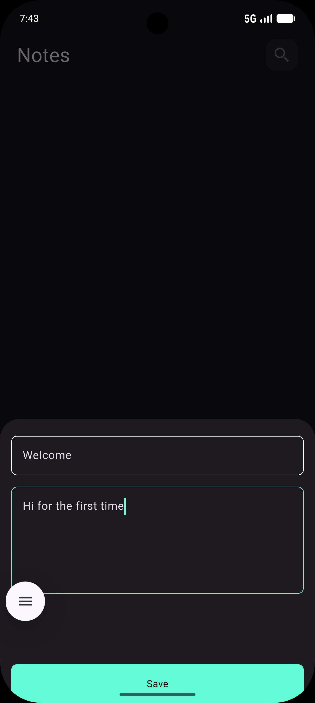
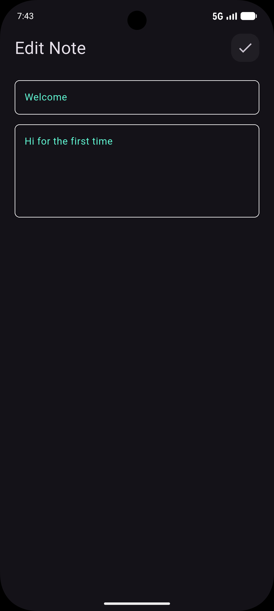
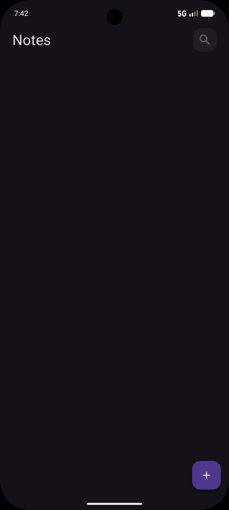

# 📝 Simple Notes App - Flutter

<div align="center">


**A lightweight and functional Notes application built with Flutter.** 📱

</div>

---

## 📱 About The Project

**Simple Notes App** is a productivity application designed to help users quickly create, manage, and organize their daily notes. The project focuses heavily on core functionality and data persistence rather than complex UI design. 

Users can easily add new notes, edit existing ones, and delete them when they are no longer needed. The app handles empty states gracefully.

---

## 📸 Screenshots

<div align="center">

| Add New Note | Edit Existing Note | Empty State (After Deleting All) |
| :---: | :---: | :---: |
|  |  |  |

</div>

---

## ✨ Features

- ➕ **Add Note:** Create a new note with a title and content.
- ✏️ **Edit Note:** Update existing notes to fix typos or add more information.
- 🗑️ **Delete Note:** Remove unwanted notes with a single tap.
- 📭 **Empty State:** The app displays a clean placeholder screen when all notes are deleted.
- 💾 **Local Storage:** Notes are saved persistently ( using  Hive).

---

## 🔄 App Flow

1. **Home Screen** ➡️ Displays a list of all saved notes.
2. **Add Screen** ➡️ Allows the user to write and save a new note.
3. **Edit Screen** ➡️ Allows the user to modify an existing note.
4. **Delete Action** ➡️ Removes the note; if all notes are deleted, an Empty State screen appears.

---

## 🛠️ Tech Stack

| Technology | Purpose |
|------------|---------|
| **Flutter & Dart** | UI Framework & Language |
| **State Management** | `Cubit`  |
| **Local Database** | Hive |

---

## 🚀 How to Run

1. **Clone the repository:**
   ```bash
   git clone https://github.com/maramrmilad7/simple-notes-app.git
